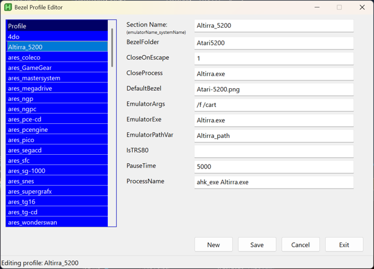

# Bezel Display — Master launcher bundle 

## Overview 

This combination is intended to provide bezel overlay functionality to a set of standalone emulators similar to what Retroarch and native MAME emulation applications provide. 

The files included with the bundle described in the ‘Files’ section assume a number of items and/or require editing. 

1. No installation needed. Just extract the zip to a location that isn’t write protected and follow the editing info below in step 4.

2.  The emulators listed in the _paths.ini and profiles.ini files are already configured and work as intended. The emulators in this file have been tested as of this release and should work fine as long as the next step is followed. 

3. The emulators should be configured to start in a full screen borderless mode (during testing, using DirectX mode seemed to work best to allow showing a bezel overlay, but each system is different, so you may have to try each graphics option offered by your emulator(s) to see which one works best for you). If configured to use exclusive full screen, the bezels will not display when the emulator is called from the bezel_launcher.exe script. 

4. The _paths.ini file provided should be edited to reflect your emulator installation locations. 

5.	For the curious, both the bezel_display.ahk and bezel_launcher.ahk files have numerous remarks to allow understanding function and purpose. Reviewing both will be very helpful in using this bundle. 

6. These files are structured around pulling game and default bezels from a standard Retroarch overlay directory structure. The easiest way of displaying and using bezel files for numerous games run by various emulators is to setup a Retroarch structure with overlays either manually, or by using the Windows utility from The Bezel Project GitHub page: <u>https://github.com/thebezelproject/BezelProject-Windows</u> The Windows app will pull bezel packs from GitHub and install a default bezel into the retroarch\overlays folder and game bezel packs into the retroarch\overlays\GameBezels folder. 

Note: As with Retroarch, the game/rom name passed must match the same names used for the bezel png files. 

## Files 

|**File**|**Role**|
|---|---|
|**bezel_display.ahk/exe**|Master AutoHotkey v2 script. Compile to bezel_display.exe. Shows the loading splash and draws the bezel overlay.|
|**bezel_display.ico**|Custom icon used when compiling bezel_display.ahk and bezel_launcher.ahk.|
|**bezel_launcher.ahk/exe**|Master game launcher. Reads settings from profiles.ini, starts bezel_display.exe, then starts the real emulator.|
|**_paths.ini**|Your install-folder paths (ares_path, bgb_path, ...), loaded by bezel_launcher.exe. Sample included — edit the paths for your PC.|
|**profiles.ini**|One [Settings] section (global) + one [ProfileName] section per emulator_system combo. This is the only file you edit to add new setups. See remarks at the top of the file for further info.|
|**profile_editor.ahk/exe**|Simple ahk based interface to allow editing of profiles.ini.|
|**Readme.pdf**|This document|

## How it's called 

Both master files take the same two arguments: 

- bezel_launcher.exe "[ProfileName]" "[FullPathToGameFile]" 

- bezel_display.exe   "[ProfileName]" "[FullPathToGameFile]” (called internally by the bezel_launcher.exe app) 

ProfileName must match a [SectionName] in profiles.ini, e.g. bgb_gbc or bizhawk_3do, etc. 

To use this bundle with a front end, just use the following format (example below): 

Bezel_launcher.exe bizhawk_7800 “full path to game rom” 

Where **bezel_launcher.exe** is basically used as the emulator to run, **bizhawk_7800** is which emulator to run (taken from the list of emulators in profile.ini), and what follows is the **full path to the rom file** (enclose in quotes if the full path has space characters in it). 

## Adding a new emulator+system profile 

1. Open profiles.ini in your favorite editor, or using the profile_editor.ahk/exe file (see Figure 1 example below). 

2. Copy the [TEMPLATE] section, uncomment it, and rename it to your new profile name (e.g. mesen_nes) if using a text editor, or click New in the profile_editor.ahk/exe file. 

3. Fill in its values (see comments in profiles.ini for what each key does or hover over an entry field in the gui for a tooltip description). If using the profile_editor.ahk/exe, enter a unique emulator_system name in the top 'Section Name' field. 

4. If it's a new emulator (not just a new system on an existing one), add its install folder to _paths.ini and reference that variable name via EmulatorPathVar= in the new profile. 

5.	Click the Save button when finished, or Cancel to not save any changes. Click on Exit, then you are done — no .ahk code or other changes needed. 

_Figure 1_ 

## profiles.ini key reference 

|**Key**|**Meaning**|
|---|---|
|**RAHomeDir (in [Settings]) **|Root of your RetroArch install, used only as a bezel-image library|
|**BezelFolder**|Subfolder under overlays\GameBezels\ holding this system's bezel PNGs|
|**CloseOnEscape**|1 = pressing Escape also closes CloseProces 0 = Escape does nothing special|
|**CloseProcess**|Process name to close when CloseOnEscape=1  (usually same as the emulator exe)|
|**DefaultBezel**|Fallback PNG (under overlays\) used when no game-specific bezel exists|
|**EmulatorArgs**|Extra command-line flags the emulator needs, e.g. --fullscreen, or blank|
|**EmulatorExe**|The emulator's .exe filename|
|**EmulatorPathVar**|Name of the _paths.ini variable holding this emulator's install folder|
|**PauseTime**|Milliseconds to show the loading splash before the bezel/game appears. Set PauseTime=0 to skip the built in loading splash.|
|**ProcessName**|ahk_exe <name>.exe — window this profile watches to show/hide the bezel|

## Compiling 

Compile bezel_display.ahk to bezel_display.exe and bezel_launcher.ahk to bezel_launcher.exe with Ahk2Exe (standard AutoHotkey compiler and point to your AutoHotKey v2 bin/exe and the bezel_display.ico for both) and place the resulting .exe’s in the folder with the rest of the bundled files, alongside profiles.ini. 

